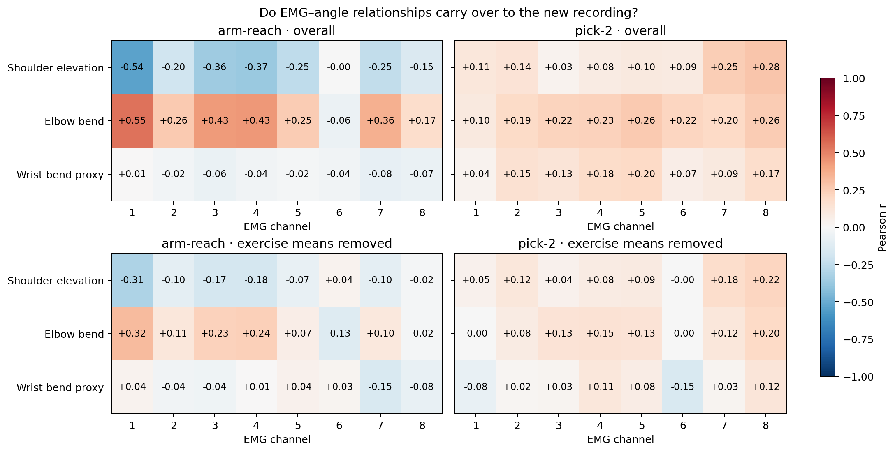
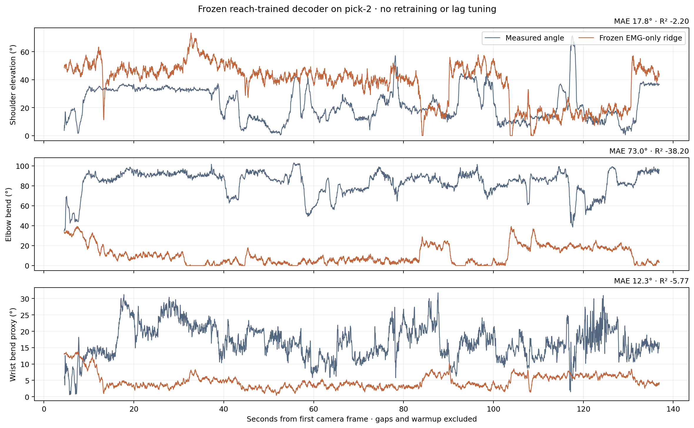
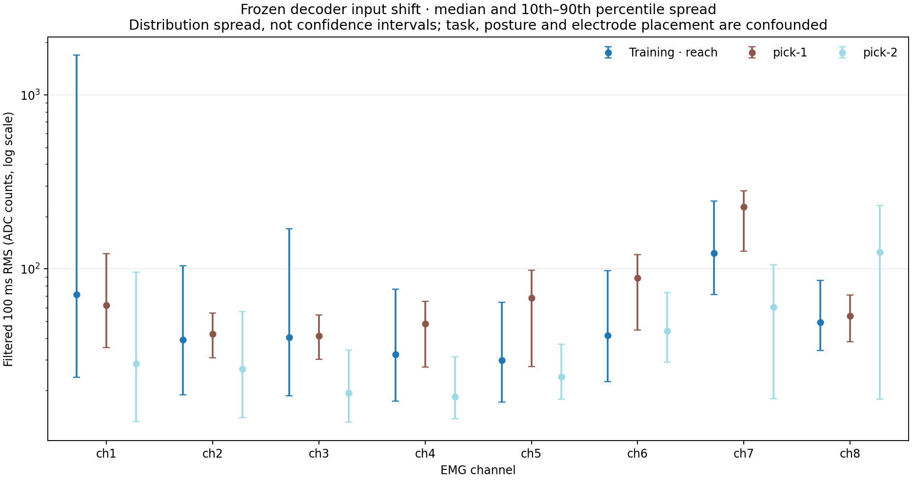

# Pick-2: cleaner acquisition, but the original decoder still fails to transfer

Yohannes pushed **pick-2** in commit `f865450` on November 7, 2026 at 16:26 Pacific.
It contains about 139 seconds of eight-channel EMG and 137 seconds of camera
landmarks, following the same two-round picking protocol as pick-1. The declared
band arm is right. No orientation/gyro file was recorded for this block.

**Recording quality improved substantially. Joint prediction did not improve.**
The unchanged reach-trained ridge model has **17.8° shoulder error and 73.0° elbow
error** on the new camera measurements. We evaluated the original frozen artifacts;
we did not train, select transformations, or adjust label timing using pick-2.

## 1. What improved in the recording?

| Acquisition check | Pick-1 | Pick-2 |
|---|---:|---:|
| Observed EMG samples per channel | 263,072 | 285,408 |
| Band connection epochs | 2 | 1 |
| Continuous EMG segments | 21 | 1 |
| Missing-sequence batches | 149 | 0 |
| Near-rail ADC samples, all channels combined | 2,976 | 0 |
| Camera frames | 4,057 | 4,088 |
| Camera `followed` pose coverage | 91.05% | 97.09% |
| Pose coverage during rounds 1 / 2 | 99.55% / 100% | 100% / 100% |

Near-rail means ADC ≤100 or ≥65435, consistently with the previous report. Pick-2
has two camera gaps longer than 150 ms; label interpolation does not bridge them.
There are 6,614 valid shoulder/elbow evaluation windows and 6,613 wrist windows.
These strongly overlapping windows are not independent observations.

The saved [preflight fist check](../../data/sessions/20261107-143640/blocks/pick-2/fist_check.json)
reports a **6.55× fist/relax RMS ratio on channel 3**, with channels 4 and 5 also
responding strongly. This is evidence of grip responsiveness during that separate
check. It does not validate shoulder/elbow reconstruction, camera synchronization,
or every channel: channel 1's ratio was only 1.34×. The saved check contains no
motion-event validation field, which the current checker now emits.

## 2. Do the old correlations replicate?

The primary comparisons reuse EMG 1, selected in arm-reach before either picking
recording arrived. Features are 100 ms causal filtered log-RMS, at approximately
20 ms intervals. Angle geometry and the fixed +50 ms label offset are unchanged.

| EMG 1 relationship | Arm-reach r | Pick-1 r | Pick-2 r [descriptive 95% interval] |
|---|---:|---:|---:|
| Shoulder elevation | −0.535 | +0.166 | +0.114 [−0.100, +0.324] |
| Elbow bend | +0.546 | +0.129 | +0.099 [−0.191, +0.336] |



Both new intervals span zero. Removing each exercise's mean leaves pick-2 EMG 1
correlations of **+0.045 for shoulder and −0.003 for elbow**. Spearman correlations
are +0.163 and +0.074. None of these checks recovers the earlier strong pattern.

Across all 24 channel/joint pairs, the largest absolute whole-record Pearson r is
only **0.281** (channel 8–shoulder); the largest after exercise demeaning is 0.216.
Those channel searches are exploratory. Round-to-round changes also matter:
channel 1–elbow is −0.260 in round 1 and +0.162 in round 2.

These results concern this amplitude feature and these recorded movements. They
do not rule out multichannel, nonlinear, temporal, or movement-intent information.

## 3. Frozen-model accuracy

| Camera label | Pick-1 ridge MAE | Pick-2 ridge MAE [95% interval] | Pick-2 frozen mean MAE | Pick-2 ridge R² |
|---|---:|---:|---:|---:|
| Shoulder elevation | 12.7° | 17.8° [14.8, 21.1] | 18.5° | −2.20 |
| Elbow bend | 43.9° | 73.0° [68.2, 77.6] | 42.9° | −38.20 |
| Wrist-bend proxy | 15.2° | 12.3° [11.0, 13.7] | 5.4° | −5.77 |

The baseline always predicts the original training mean. The same ridge and
baseline artifact hashes match the previous pick-1 evaluation.



Relative to that baseline, shoulder MAE improves by only **0.7° [−2.9, +4.2]**.
Elbow error increases by **30.1° [27.7, 32.6]**, and wrist error increases by
**6.9° [6.2, 7.6]**. Elbow MAE remains poor in both rounds: 79.3° and 70.0°.
Its 90th-percentile absolute error is **90.4°**.

All R² values are negative, meaning squared error exceeds that of the new
recording's own mean. That test-set mean is a descriptive reference, distinct
from the deployable frozen training-mean baseline. Pick-2 target standard
deviations are 11.9° shoulder, 12.0° elbow, and 5.2° wrist; the smaller wrist MAE
does not establish improved tracking of this narrower range.

## 4. Where does the failure show up?

We added a **post hoc diagnostic**, without changing the predictions. The frozen
model's average elbow prediction is **10.4°**, while the measured average is
**83.4°**. The original training mean is 40.5°. About **9.9%** of pick-2 elbow
predictions hit the decoder's existing 0° output bound.

The EMG input distribution also changes:

| Channel | Training median filtered RMS | Pick-1 | Pick-2 |
|---|---:|---:|---:|
| 1 | 71.2 | 61.9 | 28.6 |
| 3 | 40.5 | 41.3 | 19.4 |
| 8 | 49.3 | 53.5 | 125.0 |

RMS values are ADC-count units after the existing causal filter, not calibrated
muscle force or electrical microvolts. The reference uses only the original
training interval. Pick-2 channel 8's median log-RMS is 2.35 training standard
deviations above the frozen training mean; channel 7 is 1.56 below it. Only 0.044%
of the actual ridge input feature values exceed its ±6-standard-deviation clamp.



We observe a change in both inputs and measured posture. These data cannot
separate task, posture, activation, electrode contact/placement, and camera
measurement changes as causes. The diagnostics do not establish which change
caused how much error. A passed fist check alone cannot make this reach-trained
mapping transferable.

## 5. Label and timing checks

The separate same-frame instructed-target versus camera-`followed` audit gives:

| Guided quantity | Pick-1 MAE / r | Pick-2 MAE / r |
|---|---:|---:|
| Signed side-view shoulder | 11.7° / 0.550 | 11.8° / 0.671 |
| Elbow using hand midpoint | 15.8° / 0.327 | 13.9° / 0.468 |

These guided labels use different geometry from the original decoder. We score
the decoder only against the original torso-relative 3D angle definitions, never
against the synthetic prompt. Target-following error includes response delay and
camera uncertainty and is not a pure camera-accuracy measurement.

Pick-2 uses the same nominal unit device-clock slope and first-60%-median receipt
offset predeclared for pick-1. Timestamp evidence is consistent: candidate OLS
slope 1.000121, host-receipt residual 5th/50th/95th percentiles −47/−2/+55 ms.
Using OLS instead changes every model MAE by **less than 0.006°** and gives EMG 1
shoulder/elbow r of +0.114/+0.100. The tested clock alternative does not rescue
transfer. Camera exposure latency and the physiological alignment remain unknown.

## 6. Interpretation and next experiment

The useful new evidence is that the failure persists with continuous EMG and
better camera coverage. Packet loss and near-rail ADC values are therefore
insufficient explanations for the current decoder's failure. A stable,
high-fidelity mapping has not been demonstrated by these three short blocks.

Keep this frozen result as the benchmark. For the next model, these examined
recordings can be development data covering multiple movement contexts; reserve
a new complete recording before selecting preprocessing or hyperparameters.
Record band placement, pose, and timing metadata so later differences can be
explained. Improving the model requires testing that transfer explicitly.

Uncertainty uses 1,000 paired block-bootstrap draws, seed 17, within acquisition
segment and round. Five-second blocks are primary (28 blocks, three strata, no
singleton strata); two- and ten-second sensitivity checks preserve the conclusions.
Intervals are pointwise descriptions conditional on these nonstationary recorded
sequences, not population guarantees or causal evidence. The blocks share one
session folder; no cross-day or cross-person generalization is established.

## Reproduce

First create the original artifacts with the commands in
[EMG_BENCHMARK.md](../../EMG_BENCHMARK.md), then use fresh output directories:

```sh
python -m neural_reflex.emg_transfer_stats \
  data/sessions/20261107-143640/blocks/arm-reach \
  data/sessions/20261107-143640/blocks/pick-2 \
  --side right --models .local/benchmark-results/chronological-v1 \
  --output .local/benchmark-results/pick-2-transfer --replicates 1000

python -m neural_reflex.label_audit \
  data/sessions/20261107-143640/blocks/pick-2 \
  --side right --output .local/benchmark-results/pick-2-labels

python -m neural_reflex.emg_shift_audit \
  data/sessions/20261107-143640/blocks/arm-reach \
  data/sessions/20261107-143640/blocks/pick-1 \
  data/sessions/20261107-143640/blocks/pick-2 \
  --models .local/benchmark-results/chronological-v1 --side right \
  --output .local/benchmark-results/pick-2-shift
```

[statistics.json](statistics.json) contains correlations, all round results,
bootstrap and timing sensitivity, quality audits, and artifact/source hashes.
[labels.json](labels.json) contains the separate camera-label audit.
[shift.json](shift.json) contains the post hoc input and output distribution audit.
All figures have PNG and PDF versions. The original decoder, gap loader,
transfer statistics, and label audit have 26 focused passing tests.
