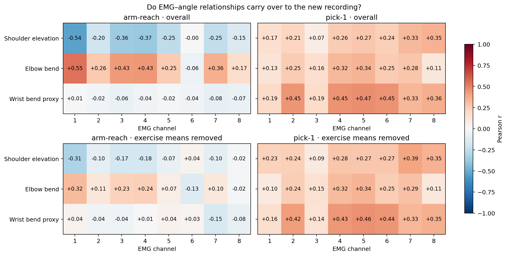
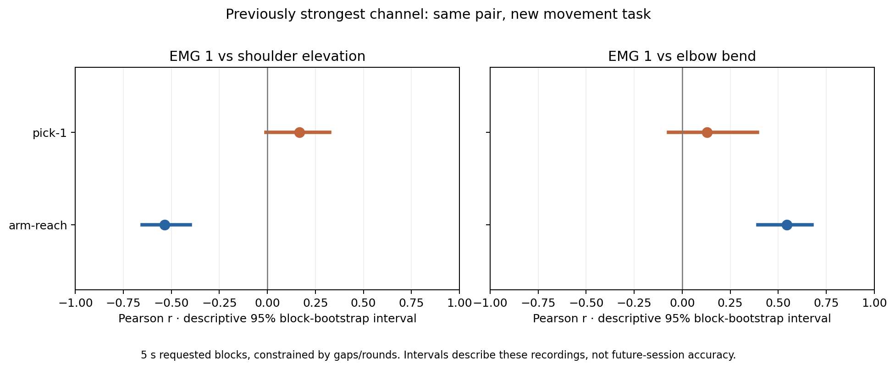
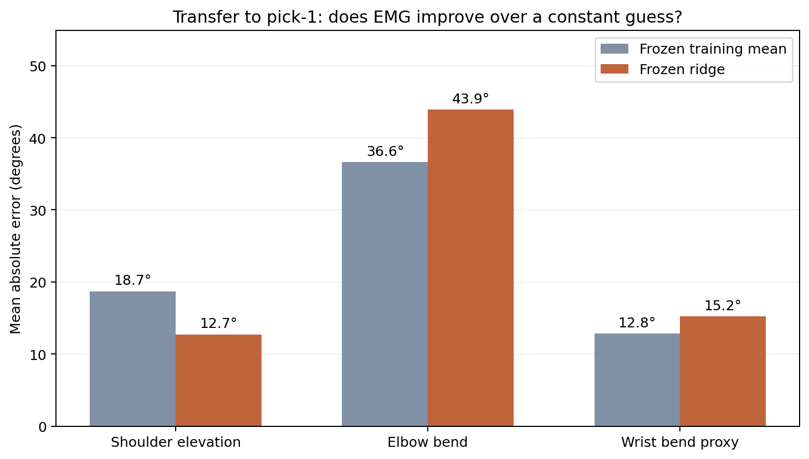
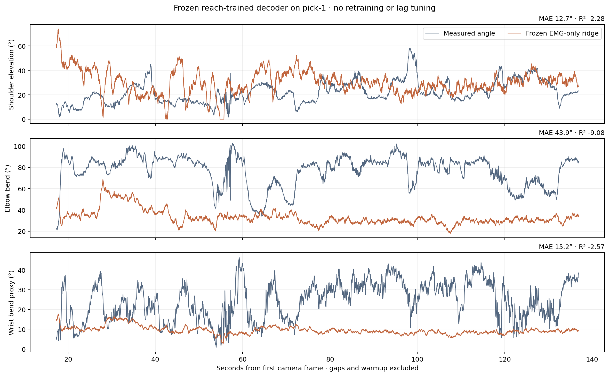
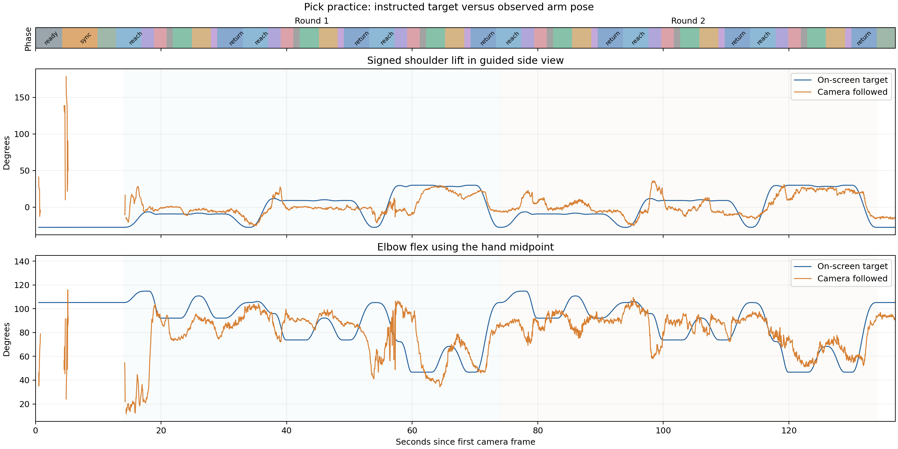

# Does the EMG relationship carry over to the new picking recording?

**The first recording's strongest channel relationships do not reliably carry
over. The unchanged decoder performs poorly on picking, especially at the elbow.**
There is still EMG–movement association in the new recording, but these two blocks
do not establish a stable, high-fidelity mapping from forearm EMG to arm angles.

This report compares `arm-reach` with Yohan's new `pick-1` from session
`20261107-143640`, pushed in commit `9ec00a9`. Both are short blocks from the same
session folder; this is a test across recording blocks and tasks, not across
people or days. The right arm is the declared band arm.

## 1. What changed in the correlations?



Both blocks use the same 100 ms causal filtered log-RMS features, approximately
20 ms hop, fixed +50 ms camera-label offset, and the original torso-relative 3D
angle definitions. We compare EMG 1 first because it was the strongest channel in
the earlier analysis, before the picking data arrived. All other channel searches
are exploratory.

| EMG 1 relationship | Arm reach: r [95% interval] | Picking: r [95% interval] |
|---|---:|---:|
| Shoulder elevation | −0.535 [−0.651, −0.402] | +0.166 [−0.007, +0.325] |
| Elbow bend | +0.546 [+0.395, +0.676] | +0.129 [−0.070, +0.393] |

These are **descriptive, pointwise block-bootstrap intervals**, conditional on the
recorded sequences. They are not simultaneous population confidence statements.
The original shoulder relationship's negative sign is not reproduced. The new
elbow relationship is much weaker, with its interval spanning zero.



Additional checks:

- Subtracting each exercise's mean leaves shoulder/elbow r of **−0.308/+0.318**
  in reach versus **+0.230/+0.097** in picking. This reduces exercise-level mean
  effects; it does not fully control for cue, movement phase, or time.
- Spearman rank correlation on EMG 1 is **−0.565/+0.580** in reach versus
  **+0.276/+0.267** in picking. Using ranks does not restore the old pattern.
- Removing windows containing near-rail ADC samples gives **−0.524/+0.555** in
  reach versus **+0.202/+0.161** in picking. Saturation alone does not explain
  the difference. This subset is diagnostic, not a replacement for primary scores.
- Pick round 1/round 2 EMG 1–elbow r is **+0.103/+0.439**. Association also varies
  within the new recording.
- Other channels correlate with the picking wrist-bend proxy up to approximately
  **+0.47**. These were identified after seeing the new data. The label is unsigned
  and can covary with gripping or whole-arm movement; this is not proof of
  independent wrist control.

## 2. Does the existing model work on the new recording?

We loaded the previously validation-selected ridge and its constant training-mean
baseline, then evaluated both on pick-1. **No retraining, recalibration from joint
labels, model selection, or lag optimization was performed on pick-1.**

| Target | Frozen ridge MAE | Descriptive 95% interval | Frozen training-mean MAE | Ridge R² |
|---|---:|---:|---:|---:|
| Shoulder elevation | 12.7° | 10.0–15.9° | 18.7° | −2.28 |
| Elbow bend | 43.9° | 39.6–48.4° | 36.6° | −9.08 |
| Wrist-bend proxy | 15.2° | 13.4–17.2° | 12.8° | −2.57 |



The paired bootstrap estimates a shoulder MAE reduction of **6.0° [3.5, 8.2]**
relative to the frozen mean, but an elbow **increase of 7.3° [4.9, 9.2]** and
wrist increase of **2.4° [1.9, 2.8]**. Those directions are unchanged with two- or
ten-second resampling blocks. The model underpredicts elbow bend by **43.6° on
average**, and its 90th-percentile elbow absolute error is **59.5°**.

Shoulder movement in the picking evaluation is much narrower (standard deviation
9.2°) than in reach (about 35° across correlation windows). Consequently, the
smaller shoulder MAE should not be interpreted as improved tracking. All three
R² values are negative: each output has greater squared error than a constant
equal to that new target's own mean. That test-set mean is an explanatory reference,
not the deployable training-mean baseline shown in the table.



## 3. Is the instructed target a valid motion label?

The new file contains both the synthetic on-screen `target` and camera-measured
`followed` movement. Their agreement is imperfect:

| Guided quantity | Same-frame target/followed MAE | Pearson r |
|---|---:|---:|
| Signed side-view shoulder lift | 11.7° | 0.550 |
| Elbow flex using hand midpoint | 15.8° | 0.327 |

Elbow target-following improves from round 1 (**20.0° MAE, r=0.115**) to round 2
(**11.5° MAE, r=0.700**). Prompted targets should therefore not be treated as exact
measured angles when the goal is reconstructing human motion.



This label audit is separate from the decoder evaluation: guided shoulder is
signed in a side view and guided elbow extends to the hand midpoint. The frozen
decoder uses unsigned torso-relative shoulder elevation and elbow-to-wrist
geometry, consistently on both blocks. We did not mix these definitions or score
the model against instructed targets. Camera measurements themselves remain an
imperfect reference; target-following error is not solely human performance error.

## 4. Recording quality and timing sensitivity

| Quantity | Arm reach | Pick-1 |
|---|---:|---:|
| Camera duration | 133.0 s | 137.0 s |
| Camera frames | 3,972 | 4,057 |
| Observed EMG samples per channel | 276,144 | 263,072 |
| Continuous EMG segments | 1 | 21 |
| Missing-sequence batches | 0 | 149 (1.16 s at nominal sample rate) |
| Connection epochs | 1 | 2 |
| Correlation windows retained | 6,568 | 6,004 |

Pick-1 has one **9.485-second host receipt gap at reconnection**. Its 19 additional
sequence gaps are concentrated near startup; the final uninterrupted raw segment
contains about 121.6 seconds of EMG. Filters reset and discard a one-second warmup
after each gap. Decoder history is approximately 700 ms and never spans a gap.
There are **5,974 valid decoder evaluation windows**, with strong overlap rather
than 5,974 independent observations.

The camera reports `followed` on 91.05% of frames overall, but coverage during
the two actual picking rounds is 99.55% and 100%. Missingness is concentrated in
setup. Original benchmark geometry has valid shoulder/elbow/wrist labels on
92.28% / 91.05% / 90.83% of frames respectively.

Startup Bluetooth receipt backlog distorts a naïve clock fit. The first-60%-OLS
device-to-host slope in the main pick epoch is 0.994928, whereas its middle-half
slope is about 1.000082. Before inspecting new model/correlation outcomes, we
selected a nominal unit clock slope with a median receipt offset from the first
60% of each epoch. The source block retains its original mapping. No camera
labels were used to choose this timing method.

As a predeclared sensitivity check, the original OLS mapping gives shoulder/elbow
r of **+0.163/+0.122**, versus primary **+0.166/+0.129**. Frozen-model MAE changes
by less than **0.06°** on every output. The tested clock alternative does not change
the transfer conclusion. Camera exposure delay and physiological latency still
have not been measured; the +50 ms label offset remains an assumption.

## 5. Statistical interpretation

We use Pearson and Spearman effect sizes rather than ordinary independent-sample
p values. For uncertainty, we resample paired time blocks 1,000 times, seed 17,
within acquisition segment and recorded round. Five seconds is primary; two and
ten seconds are sensitivity checks. Blocks never cross an EMG acquisition gap;
missing camera rows within a wall-time block are omitted without compressing time.

The primary correlation analysis has 27 source blocks and 25 picking blocks;
median actual span is approximately five seconds. Picking has one singleton
stratum that remains fixed during bootstrap. Partial blocks are retained and their
sizes are reported. Scripted, nonstationary movements and fixed singleton strata
limit the interpretation of these percentile intervals. The old best-channel
selection also makes its source intervals exploratory. No population-level
significance, simultaneous 95% guarantee, or causal identification is claimed.

The useful finding is a failed practical transfer test. It is consistent with
task/posture-dependent relationships, label differences, and limited training
coverage. These results do not isolate which cause dominates or show that EMG
contains no useful information. They show the current decoder is not ready for
accurate multi-joint control.

## Next experiment

Record additional blocks covering both reaching and picking, with varied starting
postures, holds, and movement order. Preserve measured motion labels, synchronize
the streams, and reserve a complete new recording before selecting transforms or
models. Train on multiple movement contexts and test once on that reserved block.
Pick-1 has now been examined extensively and should be treated as development data
in later model comparisons.

## Reproduce

Use the dependencies and original artifact-training command in
[EMG_BENCHMARK.md](../../EMG_BENCHMARK.md). Then:

```sh
python -m neural_reflex.emg_transfer_stats \
  data/sessions/20261107-143640/blocks/arm-reach \
  data/sessions/20261107-143640/blocks/pick-1 \
  --side right --models .local/benchmark-results/chronological-v1 \
  --output .local/benchmark-results/pick-transfer --replicates 1000

python -m neural_reflex.label_audit \
  data/sessions/20261107-143640/blocks/pick-1 \
  --side right --output .local/benchmark-results/pick-labels
```

[statistics.json](statistics.json) includes every channel correlation, Spearman
coefficient, round result, block-size sensitivity, camera-label distribution,
packet-gap boundary, clock diagnostic, and frozen artifact/source SHA256 hash.
[labels.json](labels.json) contains the separate label audit. All five figures
are supplied as PNG and PDF. The loader, label audit, transfer analysis and existing
decoder have **26 focused passing tests**. No robot control was used.
