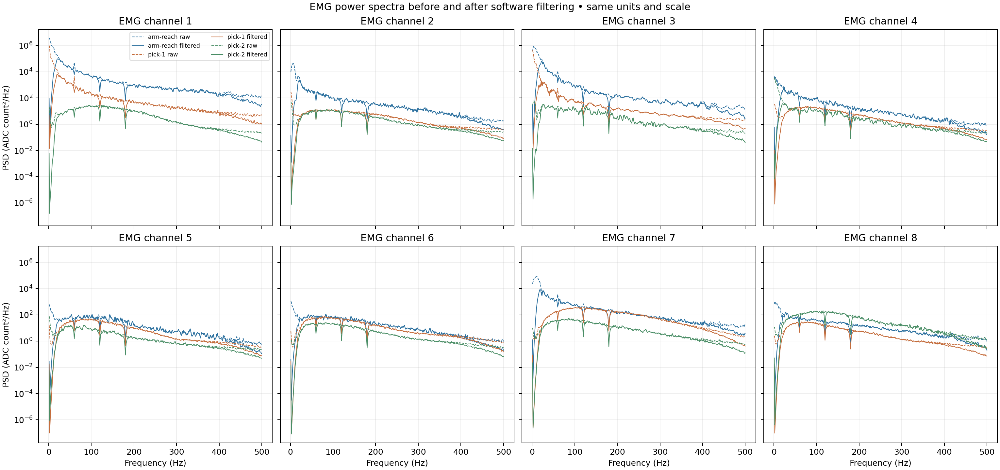
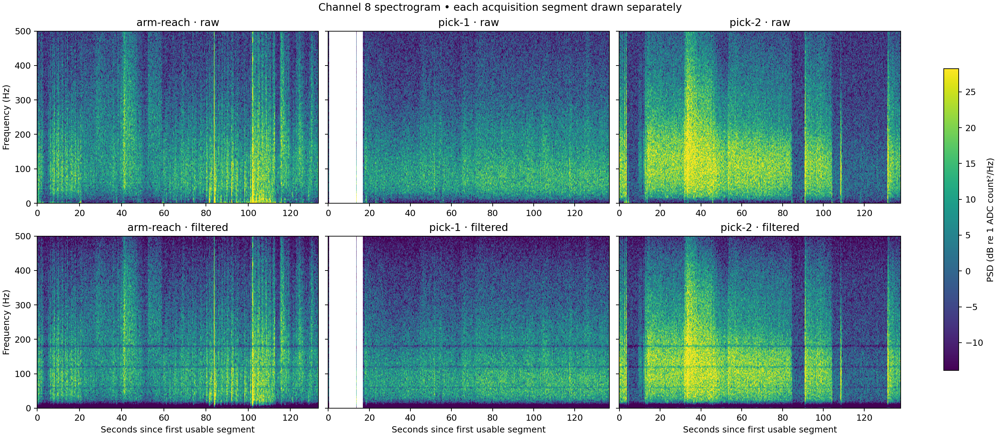
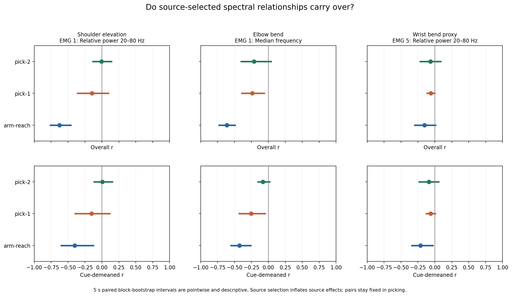
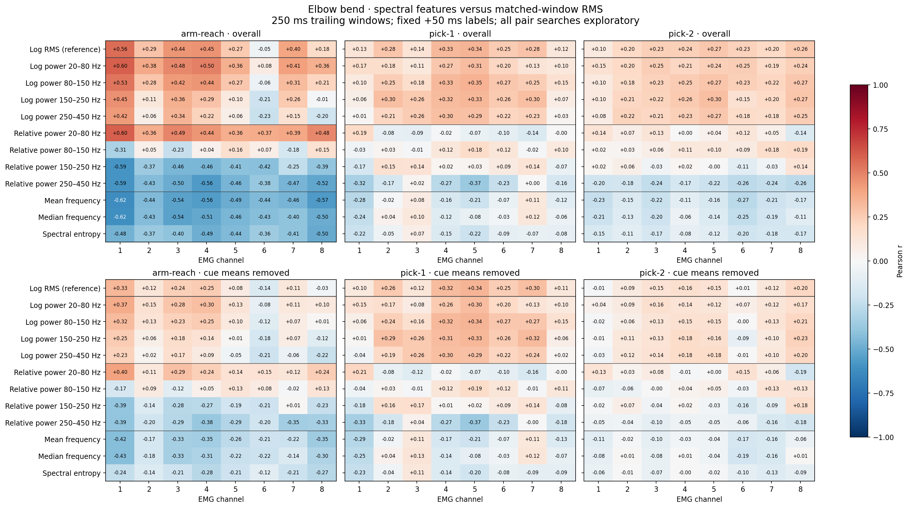

# EMG spectral analysis and joint-angle correlations

**Spectral features reveal associations in the original recording and a smaller
elbow association in pick-1. They do not establish a stable mapping in pick-2.**
The spectral inspection also shows that pick-2's stronger channel 8 activity is
spread across a broad frequency range, rather than dominated by a 60 Hz peak.

We analyzed all eight channels in `arm-reach`, `pick-1`, and `pick-2` from session
`20261107-143640`. The right arm, camera-angle geometry, clock mappings and +50 ms
label offset are unchanged from the earlier reports. This analysis measures
association; no decoder was retrained or robot operated.

## 1. What the spectra show



Dashed lines show the recorded waveform before software filtering; solid lines
show the existing causal 20–450 Hz bandpass and 60/120/180 Hz notches. Hardware
filtering is not characterized here. The vertical axes use the same logarithmic
ADC-count²/Hz scale, rather than separately normalizing each recording.

| Channel 8 acquisition statistic | Arm-reach | Pick-1 | Pick-2 |
|---|---:|---:|---:|
| Mean raw power, 2–500 Hz (ADC count²) | 17,479.7 | 3,429.4 | 26,485.5 |
| Mean conditioned power, 2–500 Hz | 8,666.2 | 3,098.3 | 23,947.6 |
| Conditioned/raw power | 49.6% | 90.3% | 90.4% |
| Raw power below 20 Hz, within 2–500 Hz | 46.3% | 1.0% | 0.5% |
| Raw power in 58–62 Hz, within 2–500 Hz | 1.8% | 3.6% | 2.3% |

Pick-2 channel 8 has **7.7× pick-1's raw power** and retains 90.4% of its measured
2–500 Hz power after conditioning. Its raw spectrum peaks at 113 Hz, with broad
energy around that region. These observations do not support a dominant 60 Hz
spike as the explanation for the increased amplitude. They do not distinguish
muscle activity from broadband artifacts or contact/placement changes.

The source recording also differs substantially at low frequencies: across
channels, the median raw 2–20 Hz fraction is **71.3% in arm-reach**, versus
3.0% in pick-1 and 3.7% in pick-2. This is an acquisition difference, not a
diagnosis of its physical cause. Spectral power is not calibrated muscle force.



The spectrogram uses a shared absolute dB scale. Each acquisition segment is
drawn separately; blank regions are not interpolated. PSD and spectrogram
diagnostics use usable EMG regardless of camera visibility. Their whole-record
mean powers should not be confused with the previous training-interval median
RMS values, which use different windows and summaries.

## 2. Do spectral relationships carry across recordings?

For each joint, we selected the spectral feature/channel with the largest
absolute correlation **after removing cue means in arm-reach**. We then kept
that feature/channel fixed in both picking blocks. The source selection is
exploratory and inflates the apparent source effect; the picking results do not
reselect a favorable channel.

### Whole-record Pearson correlations

| Fixed spectral feature and target | Arm-reach | Pick-1 | Pick-2 |
|---|---:|---:|---:|
| EMG 1 relative 20–80 Hz power → shoulder | −0.629 | −0.147 | −0.005 |
| EMG 1 median frequency → elbow | −0.616 | −0.239 | −0.214 |
| EMG 5 relative 20–80 Hz power → wrist proxy | −0.153 | −0.059 | −0.067 |

### After removing each exercise cue's mean

| Same fixed pair | Arm-reach r | Pick-1 r [95% interval] | Pick-2 r [95% interval] |
|---|---:|---:|---:|
| Shoulder | −0.401 | −0.153 [−0.395, +0.114] | +0.007 [−0.115, +0.153] |
| Elbow | −0.427 | −0.254 [−0.432, −0.051] | −0.081 [−0.154, +0.020] |
| Wrist proxy | −0.212 | −0.062 [−0.128, +0.006] | −0.090 [−0.232, +0.055] |

Intervals are **pointwise descriptive 5-second block-bootstrap intervals**.
They are not independent-window p values, population confidence guarantees, or
proof that the features control a joint.



The elbow association partially carries to pick-1. In pick-2 it is much smaller
after cue demeaning, and its primary interval includes zero. The same pick-2
pair has whole-record Spearman correlation −0.114, also weaker than its Pearson
value. Pick-2 round 1/2 whole-record elbow correlations are −0.127/+0.019.

Cue demeaning removes differences between exercise averages. It does not fully
control movement phase, posture, fatigue, elapsed time, or other shared causes.
Spectral features can also be redundant with amplitude; these correlations do
not establish additional information beyond the existing multifeature decoder.

## 3. Are any new features better correlated than RMS?

The table below searches each family separately in pick-2, using **identical
250 ms windows and labels** for spectral features and RMS:

| Camera target | Best absolute RMS r across 8 channels | Best absolute spectral r across 88 candidates | Spectral candidate |
|---|---:|---:|---|
| Shoulder elevation | 0.279 | 0.328 | EMG 8 log power 250–450 Hz, positive |
| Elbow bend | 0.272 | 0.300 | EMG 5 log power 150–250 Hz, positive |
| Wrist bend proxy | 0.198 | 0.312 | EMG 6 mean frequency, negative |

These are **exploratory maxima with unequal search sizes**, not a fair model
performance comparison. Searching more features gives more opportunities for a
large coefficient. After cue demeaning, the largest absolute spectral values
anywhere in pick-2 are 0.258 shoulder, 0.228 elbow, and 0.275 wrist; the winning
features can change. The full matrices retain every tested pair.



Also see [shoulder correlations](correlations_shoulder_lift.png) and
[wrist-proxy correlations](correlations_wrist_flex.png). Spectral features show
some association with motion, but this analysis does not demonstrate improved
held-recording angle error or repair the earlier frozen decoder's elbow failure.

## 4. Sensitivity and data checks

- **125 ms windows:** fixed shoulder cue-demeaned r is −0.373/−0.144/−0.003
  across reach/pick-1/pick-2; elbow is −0.419/−0.227/−0.042. The pick-2 primary
  intervals still span zero. We did not select a different source pair for the
  shorter-window analysis.
- **Bootstrap block length:** pick-1's reduced elbow association remains negative
  with 2/5/10-second blocks. Pick-2's 250 ms elbow interval barely excludes zero
  with 2-second blocks (cue-demeaned interval approximately [−0.139, −0.001]),
  but spans zero with the primary 5-second and alternative 10-second blocks.
  A threshold-based conclusion would therefore depend on the resampling choice.
- **Near-rail samples:** removing affected 250 ms windows leaves source shoulder
  overall/within-cue r at −0.603/−0.379 and elbow at −0.619/−0.435. Pick-1 elbow
  becomes −0.260/−0.278. Pick-2 has no near-rail windows, so this exclusion changes
  nothing there. This diagnostic does not establish artifact-free measurements.
- **Continuity and visibility:** 6,561 / 5,997 / 6,615 primary windows survive in
  reach/pick-1/pick-2. No input window crosses an acquisition gap. Camera gaps
  above 150 ms are excluded and wrist labels have their own finite mask.
- **Dependent observations:** the primary bootstrap has 27 / 25 / 28 wall-time
  blocks, rather than thousands of independent examples. Pick-1 has one singleton
  stratum held fixed during resampling; this limits its uncertainty estimate.

## 5. Processing details

The [saved protocol](protocol.json) was written before inspecting spectral
associations. Each channel has twelve features: log1p RMS; log1p power in four
bands (20–80, 80–150, 150–250, 250–450 Hz); the corresponding fractions of total
20–450 Hz power; mean frequency; median frequency; and normalized spectral entropy.
The four relative powers sum to one, so they are not independent features.

Correlation features use **unrectified**, causally conditioned EMG. Trailing
windows are demeaned and multiplied by a periodic Hann window before a correctly
scaled one-sided periodogram. There is no zero padding. The primary 512-sample
window lasts 250 ms with 4 Hz bin spacing; the 256-sample sensitivity lasts 125 ms
with 8 Hz spacing. Hann-window resolving ability is broader than bin spacing.
Both use 41-sample hops (about 20 ms), independent filter state per segment and a
one-second warmup. The RMS reference uses the same samples without Hann weighting.

Acquisition PSDs use 1-second Hann windows with 50% overlap, pooled by window
count across segments; spectrograms use 0.5-second windows and 0.125-second hops.
Near-rail samples are retained in primary analyses. No lag search, per-recording
joint calibration, or learned feature transformation was introduced.

We resample paired wall-time blocks 1,000 times, seed 17, within acquisition
segment and round. Cue means are recomputed **inside every bootstrap draw**.
All 88 spectral pairs per joint are exploratory; selected-pair intervals do not
correct for source selection or provide simultaneous coverage. Three short
recordings from one session folder do not establish cross-day/person robustness.

The methods follow standard spectral scaling and EMG interpretation principles:
[SciPy spectral analysis](https://docs.scipy.org/doc/scipy/tutorial/signal.html#spectral-analysis)
and [Muceli & Merletti's EMG frequency-analysis tutorial](https://doi.org/10.1016/j.jelekin.2024.102937).

## 6. Reproduce and inspect

Use NumPy, SciPy and Matplotlib as described in [EMG_BENCHMARK.md](../../EMG_BENCHMARK.md).
Run from the repository root, using fresh output directories:

```sh
python -m neural_reflex.emg_spectral_diagnostics \
  data/sessions/20261107-143640/blocks/arm-reach \
  data/sessions/20261107-143640/blocks/pick-1 \
  data/sessions/20261107-143640/blocks/pick-2 \
  --side right --output .local/benchmark-results/spectral-diagnostics

python -m neural_reflex.emg_spectral_analysis \
  data/sessions/20261107-143640/blocks/arm-reach \
  data/sessions/20261107-143640/blocks/pick-1 \
  data/sessions/20261107-143640/blocks/pick-2 \
  --side right --replicates 1000 \
  --output .local/benchmark-results/spectral-correlations
```

[correlations.json](correlations.json) contains all coefficients, sample counts,
per-round checks, both window lengths, interval sensitivities and input hashes.
[diagnostics.json](diagnostics.json) contains acquisition power summaries;
[spectra.npz](spectra.npz) stores aggregate spectra, not raw sample recordings.
All six figures are supplied as PNG and PDF. Ten new spectral/statistical
invariant tests and fourteen existing loader/transfer tests pass (**24 total**).

**Practical conclusion:** keep spectral features as candidates for a later
controlled decoder comparison. The present evidence supports modest associations
and partial transfer in pick-1, with weak replication in pick-2. Any claim of
better angle accuracy needs an actual held-recording prediction experiment.
