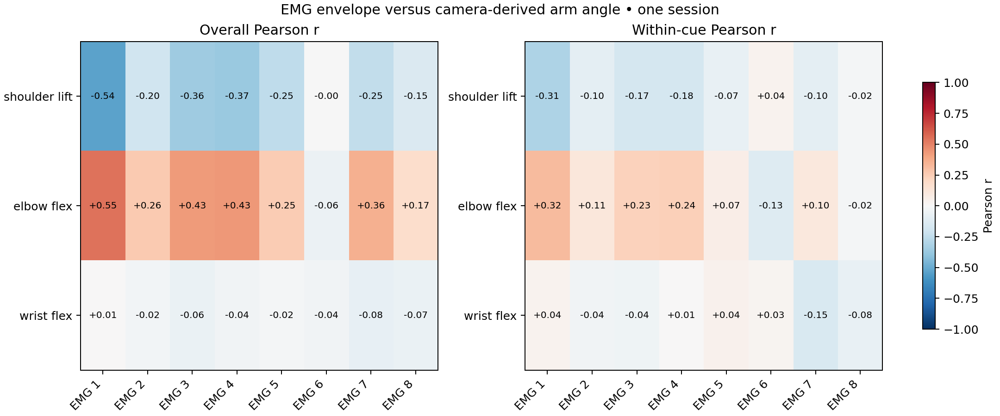
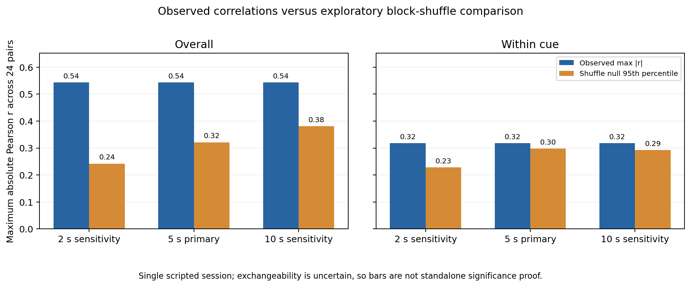
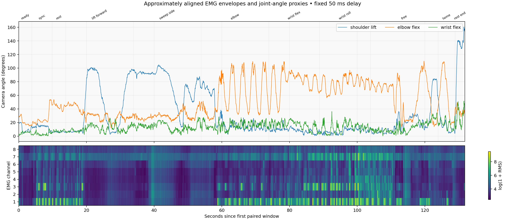

# Is the recorded EMG related to arm angle?

**There is a moderate association with shoulder and elbow angle in this recording.
It is much weaker after accounting for exercise means, and accurate angle decoding
has not been demonstrated.**

Data: collaborator recording `data/sessions/20261107-143640/blocks/arm-reach`,
pushed in `107ec3c07eaee2c00d26eb3c19ee81b6c444595c`. About 133 seconds of camera
data overlap continuous eight-channel EMG. There are 6,568 paired feature windows,
but they overlap and are **not independent observations**. The band side is assumed
to correspond to MediaPipe's right arm; it needs confirmation from the recorder.

## Correlation heatmap

The left panel shows Pearson correlation between each channel's log RMS envelope
and each camera-derived angle. Red means they increase together; blue means one
decreases as the other increases. A negative correlation can still carry predictive
information. Channel numbers here are 1–8 (raw array indices 0–7).

The right panel subtracts each exercise's mean before calculating correlation.
The strongest channel is EMG 1:

| Camera angle | Overall r | After subtracting exercise means |
|---|---:|---:|
| Shoulder elevation | −0.535 | −0.308 |
| Elbow bend | +0.546 | +0.318 |

Wrist associations are weak: every channel has absolute within-exercise r below
0.15. The wrist label is an **unsigned bend proxy**, not signed wrist flexion or
forearm rotation. No conclusion about accurately sensed wrist motion follows
from a poor camera proxy.

## Does it exceed a shuffled reference?

We shuffled contiguous EMG blocks 1,000 times, retaining the eight-channel pattern
inside each block, and compared against the largest absolute correlation across
24 channel/joint pairs. Five-second blocks were the primary comparison; two and
ten seconds check sensitivity. The right panel shows the observed association is
only slightly above the 95th-percentile shuffled reference after cue demeaning.

For the primary five-second reference (6,500 complete-block windows):

| EMG 1 pair | Cue-demeaned r | Max-over-24 adjusted empirical p |
|---|---:|---:|
| Shoulder elevation | −0.310 | 0.037 |
| Elbow bend | +0.318 | 0.028 |

These p values are **conditional on exchangeable time blocks**. This one scripted
session is nonstationary, so the comparison is exploratory, not population-level
significance or a cue-controlled independence test. Overall and cue-demeaned
analyses have separate multiple-comparison corrections. The small difference
between the heatmap and reference coefficients comes from omitting an incomplete
tail block. [Method assumptions](https://doi.org/10.1371/journal.pbio.3002758).

## Inspect the recording

The camera tracks different movements in sequential exercise periods. That can
create correlations with time or task even without a reliable joint decoder.
The input contains clipping, particularly in EMG 1 and 3 during wrist tasks.
The plots retain these data rather than selectively removing difficult windows.
The fixed +50 ms alignment is assumed; camera exposure timing was not calibrated.

## Can an EMG-only model predict unseen angles?

The benchmark trained ridge regression, RBF regression, and a small causal temporal
convolutional network. Model choice used validation only. The final chronological
20% was held out until selection was frozen, with filter resets and boundary gaps.

| Model | Shoulder MAE | Elbow MAE | Wrist-proxy MAE |
|---|---:|---:|---:|
| Constant training mean | 32.0° | 25.2° | 7.9° |
| **Ridge — selected on validation** | **26.6°** | **19.7°** | **9.6°** |
| RBF regression | 26.5° | 22.0° | 7.2° |
| Causal TCN | 25.2° | 21.6° | 9.3° |

The selected ridge model's test R² is **0.17 shoulder, 0.08 elbow, −0.52 wrist**.
It modestly improves on a constant shoulder/elbow prediction. These errors are
too large to call high-fidelity angle control. The TCN is not promoted based on
its test shoulder score; doing that would use the test set for model selection.

The validation period mostly contains wrist exercises, making its model ranking
poor evidence about reaching. The final test mostly contains free movement,
upright holding and rest. We need independent sessions with varied movement
order and static holds, confirmed sensor placement, and better timing/labels.

Open [decoder_report.html](decoder_report.html) locally for unsmoothed test
predictions and every model's metrics. [metrics.json](metrics.json) includes exact
split intervals, training configuration, source hashes and cue-specific errors.
[correlations.json](correlations.json) contains every correlation and block-length
comparison. [audit.json](audit.json) summarizes recording quality.

The model files remain local in `.local/benchmark-results/chronological-v1/`;
[EMG_BENCHMARK.md](../../EMG_BENCHMARK.md) has reproduction and reload commands.
No robot control was enabled.

PNG and PDF versions of all three figures are included. The run used Python 3.13,
NumPy 2.3.2, SciPy 1.18.1 and PyTorch 2.8.0 on local CPU, seed 7. The new audit,
benchmark and correlation modules have 19 focused passing tests, including causal
feature behavior, split isolation, model reload parity and synthetic association
checks.
